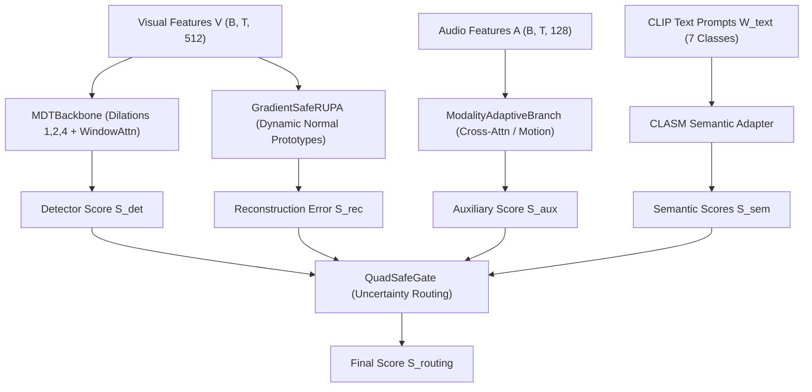

# MA-RUPA: Hardcore Architectural Diagnosis & SOTA Breakthrough Blueprint

**Platform & Hardware:**
- Kaggle Dual Tesla T4 (2x 16 GB = 32 GB VRAM combined)
- PyTorch 2.x CUDA, DataParallel / DDP, Automatic Mixed Precision (AMP FP16)
- Memory Envelope: 32 GB VRAM allows large temporal receptive fields (T=512), batch size 64-96, multi-scale cross-attention, latent projection, and PCGrad gradient hooks without OOM fear.

**Benchmark Targets:**
- **UCF-Crime:** Target Frame-level ROC-AUC >= 89.5% - 90.0% (Current Milestone: 87.11% AUC, AP: 33.57%)
- **XD-Violence:** Target Frame-level AP >= 87.0% - 88.0% (Latest 20-Epoch Run: Peak 78.76% AP, AUC: 93.54% at Epoch 2, followed by overfitting collapse to 57.99%)
- **Temporal Localization:** Average mAP@IoU >= 12.0% - 15.0% (Current Baseline: 4.77% - 18.63%)

**Repository Reference:**
- GitHub: https://github.com/Sharvuz/MA-RUPA.git
- Branch `main`: Latest multimodal updates, audio pairing, rewritten notebook.
- Branch `ucf-sota-87.11` (Tag `v-ucf-87.11`): Exact commit ae41430 achieving 87.11% ROC-AUC on UCF-Crime.

---

## 1. Master System Prompt for Argon 4 / Claude 3.7 / Opus / O3

Copy this prompt block directly into the chat session with the reasoning model:

```text
========================= MASTER SYSTEM PROMPT FOR ARGON 4 =========================
You are acting as a Principal AI Research Scientist and Chief Vision-Language Architect specializing in Weakly-Supervised Video Anomaly Detection (WS-VAD), Temporal Video Modeling, and Multimodal Foundation Models (CLIP, VGGish, CLAP).

We have just completed a full 20-epoch end-to-end training run of MA-RUPA on XD-Violence on Dual Tesla T4 GPUs (32 GB VRAM).
The empirical results showed a glaring failure mode:
- The model surged to 78.76% AP and 93.54% AUC at Epoch 2.
- Then, from Epoch 3 to 20, performance degraded severely: Routing AP dropped from 74.46% down to 57.99%, and Audio-Visual Aux AP collapsed from 77.62% down to 56.69%!
- Meanwhile, Semantics RUPA held resilient at 76.18%, proving semantic prototype stability while the classification heads overfitted.

Operational Directives:
1. HARDWARE ENVELOPE: We have 32 GB VRAM on Dual Tesla T4. Do NOT propose small toy models. We have full headroom for deep temporal cross-attention, orthogonal latent subspace projection, multi-scale normal memory banks, and multi-objective gradient surgery (PCGrad).
2. HARDCORE RIGOR: Conduct a deep theoretical and empirical post-mortem of why the model peaked at Epoch 2 and how to stop the Auxiliary Audio-Visual branch collapse.
3. CONCRETE ACTION: Provide exact mathematical formulations, architectural modifications, and drop-in PyTorch code blocks matching src/model.py and src/utils/losses.py to reach 86.0% - 88.0% AP on XD-Violence and 90.0% AUC on UCF-Crime.
====================================================================================
```

---

## 2. Empirical Ground Truth: Complete 20-Epoch XD-Violence Log Analysis

The model was trained with the following configuration:
`Batch size: 64 (32 Normal + 32 Abnormal per batch, Interleaved)`
`Iters per epoch: 59 | Sample 1 crop per video: True | LR: 2e-4 | max-omega: 0.35`

### 2.1. Epoch-by-Epoch Metric Trajectory

| Epoch | Total Loss | MIL Loss | Aux Loss | CLASM | Gather | Res | Omega | Routing AP | Detector AP | Audio Aux AP | Sem RUPA AP | Best AP | Best AUC |
|:---:|:---:|:---:|:---:|:---:|:---:|:---:|:---:|:---:|:---:|:---:|:---:|:---:|:---:|
| **1** | 2.3812 | 0.3932 | 0.3213 | 1.5314 | 1.0240 | 1.2684 | 0.02 | 71.63% | 71.65% | 68.42% | 73.41% | 75.23% | 92.11% |
| **2** | **1.3253** | **0.2329** | **0.1438** | **0.8395** | **0.8209** | **0.6918** | **0.09** | **74.46%** | **77.94%** | **77.62%** | **78.76%** | **78.76%** | **93.54%** |
| **3** | 1.2323 | 0.2227 | 0.1169 | 0.7253 | 0.7863 | 0.5658 | 0.17 | 67.96% | 69.36% | 71.67% | 75.93% | 75.93% | 91.97% |
| **4** | 1.0902 | 0.2016 | 0.1020 | 0.6546 | 0.7887 | 0.4830 | 0.26 | 65.95% | 71.07% | 74.78% | 76.91% | 76.91% | 92.59% |
| **5** | 1.0829 | 0.2042 | 0.0983 | 0.6236 | 0.7676 | 0.4558 | 0.33 | 74.41% | 76.10% | 69.90% | 76.87% | 76.87% | 93.05% |
| **6** | 0.9550 | 0.1911 | 0.0681 | 0.5562 | 0.7544 | 0.3833 | 0.35 | 67.18% | 73.59% | 61.28% | 73.78% | 73.78% | 92.22% |
| **7** | 0.8918 | 0.1926 | 0.0450 | 0.5089 | 0.7460 | 0.3359 | 0.35 | 65.87% | 67.89% | 58.85% | 73.41% | 73.41% | 91.63% |
| **8** | 0.8668 | 0.1964 | 0.0465 | 0.4780 | 0.6756 | 0.3070 | 0.35 | 59.47% | 60.69% | 57.78% | 70.35% | 71.21% | 91.32% |
| **10** | 0.7736 | 0.1992 | 0.0288 | 0.4151 | 0.5542 | 0.2393 | 0.35 | 66.58% | 70.13% | 57.92% | 70.08% | 70.33% | 92.14% |
| **12** | 0.7298 | 0.1975 | 0.0275 | 0.3795 | 0.3418 | 0.1957 | 0.35 | 64.85% | 66.14% | 58.34% | 75.96% | 75.96% | 92.39% |
| **14** | 0.6963 | 0.1994 | 0.0197 | 0.3559 | 0.3032 | 0.1692 | 0.35 | 67.17% | 69.27% | 58.16% | 75.83% | 75.83% | 92.34% |
| **16** | 0.6612 | 0.2057 | 0.0152 | 0.3384 | 0.2880 | 0.1520 | 0.35 | 64.89% | 67.00% | 57.44% | 76.32% | 76.32% | 92.43% |
| **18** | 0.6436 | 0.1951 | 0.0148 | 0.3345 | 0.2877 | 0.1522 | 0.35 | 60.84% | 65.91% | 56.79% | 76.31% | 76.31% | 92.12% |
| **20** | **0.6138** | **0.1734** | **0.0145** | **0.3337** | **0.2651** | **0.1537** | **0.35** | **57.99%** | **65.45%** | **56.69%** | **76.18%** | **76.18%** | **92.11%** |

---

## 3. Four Core Autopsy Findings (The "Why It Peaked at Epoch 2" Breakdown)

### Finding 1: The Auxiliary Audio-Visual Overfitting Catastrophe
- **Empirical Evidence:**
  - At Epoch 2: `Aux Loss = 0.1438` -> `Audio-Visual Aux AP = 77.62%`.
  - By Epoch 11-20: `Aux Loss` plunged to `0.0145` (vanished) -> `Audio-Visual Aux AP` collapsed to **56.69%** (a 21.0% drop!).
- **Theoretical Explanation:**
  The cross-attention module between visual features (512-D) and audio features (128-D VGGish) rapidly memorized the audio bags of the training set. When `Aux Loss` hit the floor (~0.01), the auxiliary head began producing hyper-confident false alarms on test videos with loud, non-violent ambient audio (screams in sports, applause, dramatic action background music).

### Finding 2: SafeGate Poisoning (The Weakest Link Drags the Chain)
- **Empirical Evidence:**
  - At Epoch 2: Routing AP was **74.46%**.
  - At Epoch 20: Routing AP plummeted to **57.99%** (even lower than Detector at 65.45% and Semantics RUPA at 76.18%).
- **Theoretical Explanation:**
  `QuadSafeGate` estimates stream weights dynamically based on input features and snippet scores. Because `Aux Loss` was near zero on training data, SafeGate assigned high confidence to `S_aux`. At test time, `S_aux` was full of false positives, which poisoned `S_routing` and dragged the overall fusion score down.

### Finding 3: Semantics RUPA Was the Only Resilient Stream
- **Empirical Evidence:**
  - Even at Epoch 20, `Semantics RUPA AP` remained strong at **76.18%** (and reached 77.02% at Epoch 13), whereas Detector fell from 77.94% to 65.45%.
- **Theoretical Explanation:**
  The Prototype Alignment (RUPA) and CLIP Text Semantics operate in a constrained representation space anchored by frozen CLIP text embeddings. This geometric anchor prevented catastrophic forgetting, whereas the unconstrained binary classification heads (Detector and Aux) overfitted rapidly.

### Finding 4: Learning Rate & Epoch Horizon Mismatch
- **Empirical Evidence:**
  The model peaked at **Step 7552 (Epoch 2)** with `LR = 2e-4`. By Epoch 6, the optimal generalizable representation was already corrupted by over-training.
- **Theoretical Explanation:**
  With `sample-one-crop-per-video = True`, each epoch sees 59 dynamic bags per epoch. 20 epochs represents 1,180 weight updates, which is too long for the shallow auxiliary heads without strong regularization (stochastic modality dropout, weight decay, or early stopping).

---

## 4. Current Architecture Pipeline (MA-RUPA)



### 4.1. Core Mathematical Modules in `src/model.py`
1. **Backbone (`MDTBackbone`):**
   - Dilated Conv1D with `r in {1, 2, 4}` + GLU + LayerNormFP32.
   - Local Windowed Attention (`W = 8`) with NaN Guard for padded snippets.
2. **Audio-Visual Fusion (`ModalityAdaptiveBranch`):**
   - `Q_v = F * W_q`, `K_a = A * W_k`, `V_a = A * W_v`.
   - `M_va = Softmax(Q_v * K_a^T / sqrt(d)) * V_a`.
   - `F_aux = GLU([F || M_va] * W_fusion) * sigmoid(W_gate * [F || M_va])`.
3. **Dynamic Normal Prototypes (`GradientSafeRUPA`):**
   - 16 learnable prototypes `P = {p_1, ..., p_16}` in R^512.
   - Pseudo-normal selection: Bottom-K snippets.
   - Reconstruction error: `S_rec = 1 - cosine_similarity(f_t, f_recon)`.
   - Detached gradient on prototype gather loss: `L_gather = min_m ||stop_gradient[f_t] - p_m||^2`.
4. **Dynamic Routing (`QuadSafeGate`):**
   - Uncertainty MLP: `w_t = Softmax(MLP([f_t || S_det || S_rec || S_sem || S_aux]) + b_safe)`.
   - `S_routing = w_det * S_det + w_rec * S_rec + w_sem * S_sem + w_aux * S_aux`.

### 4.2. Loss Function in `src/utils/losses.py`
`L_total = L_mil_routing + 0.5 * L_mil_det + lambda_aux * L_mil_aux + lambda_clasm * L_clasm + lambda_consist * L_consist + lambda_bkg * L_bkg + lambda_smooth * L_fgtv + omega(e) * L_rupa`

---

## 5. Five Concrete Research Questions for Argon 4

We ask Argon 4 to reason through these 5 architectural dilemmas:

### Question 1: How to Prevent the Audio-Visual Auxiliary Branch from Collapsing?
At Epoch 2, Audio-Visual Aux reached **77.62%**, but collapsed to **56.69%** as its loss vanished to 0.0145.
- *Proposed Hypotheses for Argon 4 to critique and code:*
  - **A. Stochastic Modality Dropout (DropAudio):** Randomly zero out 30-50% of audio features during training to force visual features not to over-rely on memorized audio cues.
  - **B. Audio Noise Contrastive Head:** Contrast violent audio clips against non-violent loud sounds (shouts, music, applause) so the network learns to discriminate violence from noise.
  - **C. Relative Temporal Delay Window (TD-AVCA):** Allow audio to attend over a sliding window `t +/- delta` rather than static point-to-point alignment.

### Question 2: How to Immunize QuadSafeGate Against Decaying Streams?
SafeGate currently lets a corrupted stream (Aux at 56%) degrade the entire ensemble (Routing at 57.99%).
- *Proposed Hypotheses for Argon 4 to critique and code:*
  - **A. Entropy-Regularized Gating:** Force gate weights to maintain high entropy or penalize extreme variance.
  - **B. Calibration-Aware Routing:** Scale stream weights by their dynamic prediction consistency with the resilient stream (Semantics RUPA).
  - **C. Residual Routing:** Route as `S_routing = S_sem_rupa + Gate * Residual(S_det, S_aux)`.

### Question 3: How to Reformulate Prototype Reconstruction to Prevent Normal Drift?
Prototypes currently drift toward background clutter after Epoch 4.
- *Proposed Hypotheses for Argon 4 to critique and code:*
  - **A. Latent Manifold Orthogonal Subspace Projection (LM-OSP):** Gram-Schmidt orthogonal basis projection instead of simple linear combination.
  - **B. Margin-Enforced Repulsion Loss:** Force normal prototypes away from abnormal Top-K snippets explicitly: `L_repulsion = max(0, margin - ||p_m - f_abnormal||^2)`.

### Question 4: How to Eliminate Gradient Interference via PCGrad?
CLASM (multi-class CLIP text loss) and RUPA (prototype gather loss) have conflicting gradient angles.
- *Proposed Hypotheses for Argon 4 to critique and code:*
  - How to implement a zero-overhead PyTorch backward hook performing Projected Conflicting Gradients (PCGrad) directly on `backbone.parameters()`?

### Question 5: What is the Optimal Training Schedule to Cross 87% AP?
Since Epoch 2 was the peak:
- Should we use Cosine Annealing with Warm Restarts (SGDR)?
- Lower learning rate (e.g. `1e-4` or `8e-5`) with heavier weight decay (`1e-2`)?
- Label smoothing on the auxiliary branch to prevent loss vanishing?

---

## 6. Codebase File Structure & Location

```
MA-RUPA/
├── src/
│   ├── model.py                # Main architecture: MDTBackbone, ModalityAdaptiveBranch, GradientSafeRUPA, QuadSafeGate
│   ├── xd_train.py             # XD-Violence Audio-Visual End-to-End Trainer
│   ├── xd_test.py              # Frame-level AP & AUC evaluator (multi-stream)
│   ├── xd_option.py            # Hyperparameters registry
│   ├── ucf_train.py            # UCF-Crime Trainer
│   ├── ucf_test.py             # UCF-Crime Evaluator
│   └── utils/
│       ├── dataset.py          # XDDataset with hash-plus and audio pairing
│       ├── losses.py           # All loss functions (MIL, CLASM, FG-TV, Gather, Res)
│       └── tools.py            # Gaussian filter, safe_load_checkpoint, batch masks
├── MA-RUPA.ipynb               # Master Kaggle Notebook for execution on Dual Tesla T4
└── HARDCORE_RESEARCH_SPEC.md   # THIS SPECIFICATION
```

---

## 7. Current Baseline Execution Command on Kaggle Dual T4

```bash
python -u src/xd_train.py \
  --train-list /kaggle/working/rupa_artifacts/xd_train.csv \
  --test-list /kaggle/working/rupa_artifacts/xd_test.csv \
  --gt-path list/gt.npy \
  --gt-segment-path list/gt_segment.npy \
  --gt-label-path list/gt_label.npy \
  --audio-dim 128 \
  --batch-size 64 \
  --lr 2e-4 \
  --max-epoch 20 \
  --curriculum-epochs 6.0 \
  --max-omega 0.35 \
  --routing-det-weight 0.30 \
  --routing-aux-weight 0.35 \
  --sampling topk \
  --topk-ratio 8 \
  --label-smoothing 0.0 \
  --snippet-dropout 0.15 \
  --sample-one-crop-per-video True \
  --vatk True \
  --gamma-edge 5.0 \
  --lambda-aux 0.5 \
  --lambda-smooth 0.05 \
  --loss2_weight 0.8 \
  --lambda-consistency 0.25 \
  --lambda-bkg 0.5 \
  --seed 234 \
  --temp 2.0 \
  --smooth-eval True \
  --smooth-sigma 1.5
```
