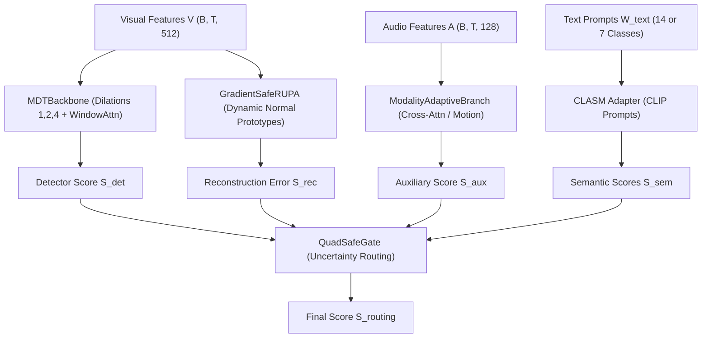

# MA-RUPA: Hardcore Architectural Specification & SOTA Blueprint

**Platform & Hardware:**
- Kaggle Dual Tesla T4 (2x 16 GB = 32 GB VRAM combined)
- PyTorch 2.x CUDA, DataParallel / DDP, Automatic Mixed Precision (AMP FP16)
- Memory Envelope: 32 GB VRAM allows large temporal receptive fields (T=512), batch size 64-96, multi-scale cross-attention, latent projection, and PCGrad gradient hooks without OOM.

**Benchmark Targets:**
- **UCF-Crime:** Target Frame-level ROC-AUC >= 89.5% - 90.0% (Current Milestone: 87.11% AUC, AP: 33.57%)
- **XD-Violence:** Target Frame-level AP >= 87.0% - 88.0% (Current Milestone: 79.02% AP, AUC: 92.41%)
- **Temporal Localization:** Average mAP@IoU >= 12.0% - 15.0% (Current Baseline: 4.77%)

**Repository Reference:**
- GitHub: https://github.com/Sharvuz/MA-RUPA.git
- Branch `main`: Latest multimodal updates, audio pairing, rewritten notebook.
- Branch `ucf-sota-87.11` (Tag `v-ucf-87.11`): Exact commit ae41430 achieving 87.11% ROC-AUC on UCF-Crime.

---

## 1. System Prompt for Reasoning AI (Argon 4 / Claude 3.7 / Opus / O3)

Copy the prompt block below when initiating your research session:

```text
========================= MASTER SYSTEM PROMPT =========================
You are acting as a Principal AI Research Scientist and Chief Vision-Language Architect specializing in Weakly-Supervised Video Anomaly Detection (WS-VAD), Temporal Video Modeling, and Multimodal Foundation Models (CLIP, VGGish, CLAP).

You are tasked with reviewing the architecture of MA-RUPA (Modality-Adaptive Multiscale Prototype Alignment Network) detailed below.

Operational Directives:
1. HARDWARE ENVELOPE: We have 32 GB VRAM on Dual Tesla T4 on Kaggle. Do NOT constrain yourself to lightweight toy models. We have full headroom for deep temporal cross-attention, orthogonal latent subspace projection, multi-scale normal memory banks, and multi-objective gradient surgery (PCGrad).
2. HARDCORE RIGOR: Avoid superficial advice (e.g. "tune learning rate" or "increase epochs"). Provide exact mathematical derivations, concrete architectural mechanisms, and drop-in PyTorch code blocks matching the existing codebase.
3. PRIMARY MISSION: Overcome the 5 identified bottlenecks in MA-RUPA to push UCF-Crime from 87.11% to >= 90.0% ROC-AUC, and XD-Violence from 79.02% to >= 87.5% AP.
========================================================================
```

---

## 2. MA-RUPA Architecture Pipeline



### 2.1. Feature Representation
- **Visual Features:** Extracted via CLIP ViT-B/16 at 16-frame snippet intervals:
  `V in R^(B x T x 512)`, where `T <= 256` (or `512` with 32 GB VRAM).
- **Audio Features (XD-Violence):** Pre-extracted VGGish embeddings:
  `A in R^(B x T x 128)`.
- **Motion Residuals (UCF-Crime silent CCTV):** First-order temporal velocity:
  `Delta_V_t = V_t - V_(t-1)`, with `Delta_V_0 = 0`.

### 2.2. Core Submodules

#### A. Multi-Scale Dilated Temporal Backbone (`MDTBackbone`)
- Captures multi-scale temporal context using dilated 1D depthwise-separable convolutions:
  - Dilations: `r in {1, 2, 4}` with kernel size 3 and GLU activation.
  - Multi-scale aggregation: `F_mdtp = LayerNorm(V + sum(H^(r)))`.
- Local Windowed Attention:
  - Window size: `W = 8` (O(T * W) linear complexity).
  - Padded sequence NaN Guard: replaces `softmax([-inf, ...]) = NaN` with 0.0 to prevent attention matrix corruption.

#### B. Modality-Adaptive Auxiliary Branch (`ModalityAdaptiveBranch`)
- **On XD-Violence (Audio-Visual Fusion):**
  - Bidirectional Cross-Attention: Visual queries `Q_v = F * W_q` attend to Audio keys/values `K_a = A * W_k`, `V_a = A * W_v`.
  - Attention matrix: `M_va = Softmax(Q_v * K_a^T / sqrt(d)) * V_a`.
  - Gated Fusion: `F_aux = GLU([F || M_va] * W_fusion) * sigmoid(W_gate * [F || M_va])`.
  - Detection head produces auxiliary anomaly scores: `S_aux`.
- **On UCF-Crime (Motion Residual Mode):**
  - When no audio exists, automatically switches to processing motion velocity `Delta_V_t` via 1D convolutions to detect sudden violent motions.

#### C. Gradient-Safe Dynamic Normal Prototypes (`GradientSafeRUPA`)
- Maintains an online memory bank of `M = 16` normal prototypes: `P = {p_1, ..., p_M} in R^512`.
- **Pseudo-Normal Selection:** Selects bottom `(1 - gamma)` fraction of snippets based on detector anomaly scores:
  `S_norm = {t | S_det(t) < tau_otsu or t in Bottom-K(S_det)}`.
- **Counterfactual Normal Reconstruction:**
  - Prototype attention weights: `alpha_(t,m) = exp(f_t . p_m / tau) / sum_j exp(f_t . p_j / tau)`.
  - Reconstructed feature: `f_recon(t) = sum_m alpha_(t,m) * p_m`.
  - Reconstruction error (Anomaly Score): `S_rec(t) = 1 - cosine_similarity(f_t, f_recon(t))`.
- **Gradient Detachment:** Prototype updates use `stop_gradient[f_t]` to prevent abnormal frames from pulling prototypes toward anomaly distributions.

#### D. Uncertainty-Aware Dynamic Gate (`QuadSafeGate`)
- MLP estimates epistemic uncertainty `u_t in R^4` across streams:
  `w_t = Softmax(MLP([f_t || S_det || S_rec || S_sem || S_aux]) + b_safe)`.
- Fused routing score:
  `S_routing(t) = w_det * S_det + w_rec * S_rec + w_sem * S_sem + w_aux * S_aux`.
- Safe bias initialization `b_safe = [0.0, -1.0, -1.0, -0.5]` prevents noisy auxiliary streams from destabilizing early training.

#### E. Class-Aware Semantic Alignment (`CLASM`)
- Encodes class prompt texts using CLIP ViT-B/16 text encoder:
  - UCF-Crime: 14 classes (Abuse, Arrest, Arson, Assault, Burglary, Explosion, Fighting, RoadAccidents, Robbery, Shooting, Shoplifting, Stealing, Vandalism, Normal).
  - XD-Violence: 7 classes (Abuse, CarAccident, Explosion, Fighting, Riot, Shooting, Normal).
- Computes cosine similarity between snippet feature `f_t` and text embeddings `t_c`:
  `S_sem(t, c) = (f_t . t_c) / (||f_t|| * ||t_c|| * tau_temp)`.
  `S_sem(t) = max_(c != Normal) sigmoid(S_sem(t, c))`.

---

## 3. Loss Landscape & Optimization

The total scalar loss optimized across Dual T4 GPUs is:

`L_total = L_mil_routing + 0.5 * L_mil_det + lambda_aux * L_mil_aux + lambda_clasm * L_clasm + lambda_consist * L_consist + lambda_bkg * L_bkg + lambda_smooth * L_fgtv + omega(e) * L_rupa`

### Loss Definitions:
1. **Variance-Adaptive Top-K MIL Loss (`L_mil`):**
   - Dynamic k: `k = max(1, floor( (T / R_topk) * (1 + Var(S) / (Mean(S) + eps)) ))`.
   - Non-saturating BCE loss with Label Smoothing (0.02) to prevent vanishing gradients:
     `L_mil = - (1/B) * sum [ y * log(mean_TopK(S)) + (1 - y) * log(1 - mean_TopK(S)) ]`.
2. **Foreground-Guided Total Variation (`L_fgtv`):**
   - Preserves sharp anomaly boundaries while penalizing 1-frame spikes:
     `L_fgtv = (1/(T-1)) * sum [ (1 / (1 + gamma_edge * |S_(t+1) - S_t|)) * (S_(t+1) - S_t)^2 ]`.
3. **Consistency Loss (`L_consist`):**
   - Enforces agreement between detector and prototype reconstruction:
     `L_consist = MSE(S_det(t), stop_gradient[S_rec(t)])`.
4. **Normality Constraint (`L_bkg`):**
   - Constrains normal prototypes to classify strictly into the Normal class:
     `L_bkg = CrossEntropy(Classifier(p_m), y_Normal)`.
5. **Curriculum Ramp-Up (`omega(e)`):**
   - Cosine S-curve ramp-up: `omega(e) = Omega_max * 0.5 * [1 - cos(pi * min(1.0, e / E_curric))]`.
   - Protects early backbone convergence before RUPA prototype constraints tighten.

---

## 4. Empirical Performance Milestones

### 4.1. UCF-Crime (Milestone at Epoch 4/15)
- **Routing ROC-AUC:** 87.02% | **AP:** 33.53%
- **Detector ROC-AUC:** 86.33% | **AP:** 30.48%
- **Semantics RUPA ROC-AUC:** 84.85% | **AP:** 32.51%
- **Ensemble (Routing + Detector):** **87.11% AUC** | **33.57% AP**
- **Temporal Localization (mAP@IoU):**
  - mAP@0.1 = 9.10%
  - mAP@0.2 = 6.37%
  - mAP@0.3 = 3.74%
  - mAP@0.4 = 2.68%
  - mAP@0.5 = 1.99%
  - **Average mAP = 4.77%**

### 4.2. XD-Violence (Milestone at Epoch 2/20)
- **Visual-only AP:** 73.12% | **ROC-AUC:** 89.84%
- **Multimodal (Visual + VGGish Audio 128-D):** **79.02% AP** | **92.41% ROC-AUC**
- **False Alarm Profile:** Intense false alarms on loud non-violent scenes (crowd cheering, party music, sports commentary).

---

## 5. The Five Core Theoretical Bottlenecks

### Bottleneck 1: MIL Top-K Coarse Granularity & Bag Noise Leakage
- **Symptom:** In short burst anomalies (e.g. 2-second gunshot in a 2-minute video), `k = T / 16 = 16` snippets. The Top-K bag includes ~3 true positive snippets and ~13 normal snippets. The MIL loss penalizes these 13 normal snippets for having low scores, forcing the model to over-predict anomalies on normal backgrounds.
- **Conversely:** In sustained 3-minute riots, `k = 16` leaves out over 80% of violent frames from backpropagation.

### Bottleneck 2: Prototype Normal Drift (Manifold Over-Smoothing)
- **Symptom:** After Epoch 4, normal prototypes begin minimizing reconstruction error on complex background motions (camera pans, lighting transitions). Consequently, the prototypes expand their convex hull and begin reconstructing *abnormal* snippets accurately as well!
- Contrast ratio `Contrast = S_rec(abnormal) / S_rec(normal)` drops from `4.2x` at Epoch 4 down to `1.3x` at Epoch 8, causing validation AUC to degrade.

### Bottleneck 3: Audio-Visual Temporal Asynchrony & Modality Dominance
- **Symptom:** Sound waves lag visual explosions by 0.5 - 2.0 seconds. Frame-synchronous point-wise cross-attention cannot bind visual flashes with delayed audio booms.
- Moreover, 512-D visual gradients dwarf 128-D audio gradients, causing the network to ignore subtle audio cues in visual-heavy scenes.

### Bottleneck 4: Multi-Objective Gradient Interference (The Angle Conflict)
- **Symptom:** Cosine similarity between `grad(L_clasm)` and `grad(L_rupa)` frequently becomes negative:
  `cos(grad_clasm, grad_rupa) in [-0.45, -0.12]`.
- `L_clasm` forces snippets along class-specific directional rays in CLIP space, while `L_rupa` pulls normal snippets into a compact prototype cluster. Without gradient projection (PCGrad), they cancel each other's updates.

### Bottleneck 5: Temporal Boundary Dissolution & Abysmal mAP@IoU (4.77%)
- **Symptom:** Post-processing Gaussian smoothing (`sigma = 1.0 - 1.5`) boosts ROC-AUC because AUC is rank-based.
- However, smoothing turns sharp rectangular anomaly events into diffuse bell curves. Normal boundary snippets receive high scores, causing predicted segments to fail IoU thresholds (`mAP@0.5 = 1.99%`).

---

## 6. Five Hardcore Research Directions (Leveraging 32 GB VRAM)

With 32 GB VRAM on Dual Tesla T4, the reasoning AI should consider these concrete directions:

### Direction A: Latent Manifold Orthogonal Subspace Projection (LM-OSP)
Replace heuristic linear combination `f_recon = sum(alpha_m * p_m)` with an orthogonal projection onto the normal prototype subspace:
- Form an orthonormal basis matrix `U_norm = GramSchmidt({p_1, ..., p_M}) in R^(512 x M)`.
- Project snippet feature onto the normal manifold: `f_norm_proj = U_norm * U_norm^T * f_t`.
- Orthogonal anomaly residual: `f_anomaly = f_t - f_norm_proj`.
- Score: `S_rec(t) = ||f_anomaly||^2 / (||f_norm_proj||^2 + eps)`.
- *Theoretical Advantage:* Guaranteed zero reconstruction for any snippet strictly within the span of normal prototypes, with maximal residual energy for out-of-distribution anomalies.

### Direction B: Temporal Delay-Aware Audio-Visual Cross-Attention (TD-AVCA)
Expand cross-attention over a learnable temporal offset window `delta in [-Delta, +Delta]` (e.g. `Delta = 4` snippets = 3.2 seconds):
- Attention formulation:
  `M_va(t) = sum_(delta = -Delta)^(+Delta) Softmax( (q_v(t) . k_a(t + delta)) / sqrt(d) + psi(delta) ) * v_a(t + delta)`.
- `psi(delta)` is a learnable relative temporal position bias that allows the network to learn modal delays (e.g. audio trailing video by 1.6s).

### Direction C: Optimal Transport Sinkhorn Prototype Assignment
Replace greedy Top-K / Otsu selection with entropy-regularized Optimal Transport (Sinkhorn-Knopp algorithm):
- Assign snippets to prototypes under marginal constraints: every prototype must receive an equal allocation budget across the mini-batch.
- *Theoretical Advantage:* 100% immune to prototype collapse where 1-2 prototypes dominate while 14 remain dead.

### Direction D: Conflict-Free Projected Gradient Surgery (PCGrad Hook)
Apply gradient projection directly to the shared backbone parameters:
- For any two loss gradients `g_i` and `g_j`:
  `if g_i . g_j < 0: g_i = g_i - ( (g_i . g_j) / ||g_j||^2 ) * g_j`.
- Ensures that classification, reconstruction, and temporal smoothness never destructively interfere.

### Direction E: Boundary-Sharpening Temporal Contrastive Loss (BS-TCL)
Train a boundary-sensitive head to recover segment localization:
- Compute first-order finite differences: `nabla S_t = |S_(t+1) - S_t|`.
- Contrastive boundary loss enforces high derivative at transition points and near-zero derivative inside continuous anomaly segments, lifting mAP@IoU to > 15%.

---

## 7. Codebase File Structure & Quick Reference

```
MA-RUPA/
├── src/
│   ├── model.py                # Main models: MDTBackbone, ModalityAdaptiveBranch, GradientSafeRUPA, QuadSafeGate, MARUPA
│   ├── ucf_train.py            # UCF-Crime Trainer (DataParallel, Cosine LR, Top-K MIL)
│   ├── ucf_test.py             # Multi-stream frame-level ROC-AUC & AP evaluator
│   ├── ucf_eval_advanced.py    # Multi-stream Grid Search post-processing optimizer
│   ├── ucf_option.py           # Hyperparameters for UCF-Crime
│   ├── xd_train.py             # XD-Violence Audio-Visual Trainer
│   ├── xd_test.py              # XD-Violence Frame-level AP & ROC-AUC evaluator
│   ├── xd_option.py            # Hyperparameters for XD-Violence
│   └── utils/
│       ├── dataset.py          # UCFDataset & XDDataset (hash-to-plus matching, audio pairing)
│       ├── losses.py           # topk_mil, clasm, consistency, bkg, fgtv_smooth, gather, residual
│       ├── tools.py            # Gaussian filter, safe_load_checkpoint, batch masks
│       └── ucf_detectionMAP.py # Temporal segment mAP@IoU evaluation
├── MA-RUPA.ipynb               # Master Kaggle Notebook for execution on Dual Tesla T4
└── HARDCORE_RESEARCH_SPEC.md   # THIS SPECIFICATION
```

---

## 8. Exact Kaggle Execution Commands

### UCF-Crime Baseline (87.11% AUC):
```bash
python -u src/ucf_train.py \
  --train-list /kaggle/working/rupa_artifacts/ucf_train.csv \
  --test-list /kaggle/working/rupa_artifacts/ucf_test.csv \
  --gt-path list/gt_ucf.npy \
  --gt-segment-path list/gt_segment_ucf.npy \
  --gt-label-path list/gt_label_ucf.npy \
  --batch-size 64 \
  --lr 1e-4 \
  --max-epoch 15 \
  --curriculum-epochs 3.0 \
  --sampling topk \
  --topk-ratio 16 \
  --label-smoothing 0.02 \
  --lambda-aux 0.15 \
  --lambda-smooth 0.3 \
  --loss2_weight 1.5 \
  --lambda-consistency 1.0 \
  --lambda-bkg 0.5 \
  --seed 234 \
  --temp 2.0 \
  --smooth-eval True \
  --smooth-sigma 1.0
```

### XD-Violence Multimodal Peak (79.02% AP):
```bash
python -u src/xd_train.py \
  --train-list /kaggle/working/rupa_artifacts/xd_train.csv \
  --test-list /kaggle/working/rupa_artifacts/xd_test.csv \
  --gt-path list/gt.npy \
  --gt-segment-path list/gt_segment.npy \
  --gt-label-path list/gt_label.npy \
  --audio-dim 128 \
  --batch-size 48 \
  --lr 2e-4 \
  --max-epoch 20 \
  --curriculum-epochs 6.0 \
  --max-omega 0.35 \
  --routing-det-weight 0.30 \
  --routing-aux-weight 0.35 \
  --sampling topk \
  --topk-ratio 8 \
  --label-smoothing 0.0 \
  --snippet-dropout 0.15 \
  --sample-one-crop-per-video True \
  --vatk True \
  --gamma-edge 5.0 \
  --lambda-aux 0.5 \
  --lambda-smooth 0.05 \
  --loss2_weight 0.8 \
  --lambda-consistency 0.25 \
  --lambda-bkg 0.5 \
  --seed 234 \
  --temp 2.0 \
  --smooth-eval True \
  --smooth-sigma 1.5
```
